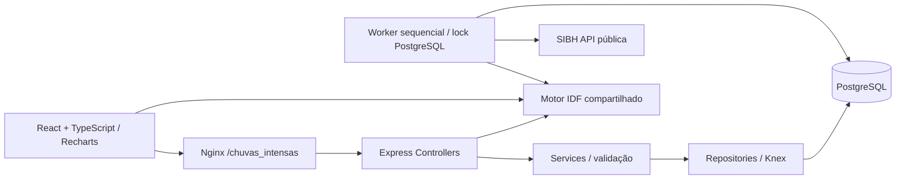

# Precipitações Intensas no Estado de São Paulo

Aplicação React/TypeScript + Vite, API Node.js/Express em camadas e PostgreSQL com migrations Knex. Inclui cálculo direto e inverso de IDF, curvas interativas Recharts, exportação CSV, mapa de estações, monitoramento SIBH, autenticação JWT, revisão de equações com histórico e Swagger/OpenAPI.

## Executar o ambiente local completo

Pré-requisitos: Docker Engine com Compose v2 ou superior e Python 3 para gerar o `.env`.

```bash
python3 scripts/init-env.py
docker compose -f docker-compose.yml -f compose.local.yml config --quiet
docker compose -f docker-compose.yml -f compose.local.yml up -d --build --wait
```

Se `.env` já existir, o gerador o preserva. A configuração local já foi gerada neste checkout. O gerador cria uma senha PostgreSQL e um segredo JWT aleatórios, sem exibi-los.

- Aplicação: **http://localhost:8089/chuvas_intensas/**
- Swagger: **http://localhost:8089/chuvas_intensas/docs/**
- OpenAPI: **http://localhost:8089/chuvas_intensas/api/openapi.json**
- Saúde da API/banco: **http://localhost:8089/chuvas_intensas/api/health**
- Saúde da sincronização: **http://localhost:8089/chuvas_intensas/api/integration/status**

O serviço `migrate` aplica migrations e importa o catálogo antes de iniciar a API. A carga é idempotente e preserva revisões existentes. O worker consulta o SIBH imediatamente e depois a cada 300 segundos. API, worker, Nginx e banco têm verificações de saúde; a primeira sincronização pode levar até 45 segundos.

Crie seu administrador, informando nome, e-mail e senha de pelo menos 14 caracteres. A senha é digitada de forma oculta; não existe uma credencial padrão:

```bash
docker compose -f docker-compose.yml -f compose.local.yml exec api node apps/api/src/create-admin.js
```

Acesse “Área operacional” para entrar. Usuários `editor` podem revisar/publicar equações; a retirada de uso e a consulta da auditoria exigem `admin`. A criação inicial por CLI produz um administrador. O papel de contas adicionais deve ser atribuído pelo responsável pelo banco.

```bash
docker compose -f docker-compose.yml -f compose.local.yml logs --tail 100 worker
docker compose -f docker-compose.yml -f compose.local.yml ps
# Parar mantendo o volume PostgreSQL:
docker compose -f docker-compose.yml -f compose.local.yml down
```

## Identidade visual do sistema

Em **Área operacional → Administração**, usuários `admin` podem enviar e visualizar o logotipo do cabeçalho e o favicon da aba do navegador. Clique em **Salvar identidade visual** para aplicar; **Descartar alterações** recupera as imagens salvas. Os botões **Usar logotipo padrão** e **Usar favicon padrão** preparam a restauração, aplicada ao salvar.

São aceitos PNG, JPEG, WebP e ICO: até **1 MB** para o logotipo e **256 KB** para o favicon. Prefira logotipo transparente legível sobre azul escuro e favicon quadrado de 32 × 32 ou 64 × 64 pixels. As imagens ficam no PostgreSQL, sobrevivem à recriação dos contêineres e são incluídas no backup do banco. Cada salvamento registra o administrador e os hashes anteriores/novos na auditoria. Editores não têm acesso às configurações.

A mudança é aplicada imediatamente na sessão que salva e carregada nas demais sessões ao abrir ou recarregar a página. A migration `006_system_branding.js` deve ser aplicada com `npm run db:migrate` antes de iniciar a API atualizada; o serviço `migrate` do Compose faz isso na inicialização. O Nginx interno aceita até 2 MB de JSON somente na rota de administração das imagens.

## Famílias de equações configuráveis

Na **Área operacional → Famílias de equações**, cadastre expressão, variáveis, valores padrão, limites e unidade. Teste a prévia e selecione a família e versão nos trechos das equações municipais. As alterações geram versões imutáveis e não mudam cálculos anteriores. Consulte o [guia de famílias](docs/equation-families.md).

## Chuva observada em mapa e tabela

Acesse **Chuva observada**, ao lado de **Mapa IDW**. O monitoramento saiu da página inicial e tem mapa Leaflet, seleção das oito janelas SIBH, alternância entre acumulado em mm e retorno em T, busca, filtros, detalhes de estações, tabela ordenável e CSV. O retorno usa verde abaixo de 10T, laranja em 10T e vermelho acima de 10T, preservando limites e qualidade. Consulte o [guia do painel](docs/observed-rainfall.md).

## Mapa Leaflet e retorno ponderado por distância

Abra **Mapa IDW** ou acesse `/chuvas_intensas/?view=spatial`. Informe chuva acumulada e duração; clique no mapa ou aplique coordenadas. O sistema identifica o município pelos 645 polígonos do IBGE e apresenta o hub de postos IDF, distâncias, pesos, retornos locais e T ponderado em anos. Há parâmetros de vizinhança, exportação CSV e tratamento de resultados censurados. Veja o [método, fontes e limites](docs/spatial-idw.md).

Depois de atualizar este checkout, aplique as migrations antes de iniciar:

```bash
npm run db:migrate
npm run dev
```

O mapa-base usa Leaflet/OpenStreetMap; os polígonos e cálculos usam a API local. O resultado IDW é exploratório e preserva os limites das equações, sem substituir retornos fora do domínio por valores exatos.

## Catálogo e conferência do estudo

`docs/source/estudo-daee-cth.pdf` é uma cópia do arquivo fornecido. Embora o nome original mencione 2019, a capa indica maio de 2018. `data/catalog.json` preserva SHA-256, autoria, estação, código IBGE, página impressa, página física, fórmula, unidade, trechos e pontos de referência. Os identificadores municipais foram associados pelo cadastro oficial do IBGE, não pelo nome de estações do SIBH.

Foram importadas **75 localidades**, com **68 equações disponíveis** após conferência numérica dos **6.120 pontos** das respectivas tabelas de intensidade. A tolerância é `max(0,25 mm/h, 1% do valor tabelado)`, para acomodar arredondamentos da publicação. A conferência computacional não equivale a homologação de engenharia.

Sete localidades permanecem **pendentes, com cálculo bloqueado**, por inconsistências na publicação:

| Município | Motivo preservado |
|---|---|
| Leme | Coeficientes da fórmula divergem da tabela. |
| Limeira | A unidade impressa mm/min leva a valores cerca de 60 vezes maiores; a tabela também contém valores incoerentes na coluna T=2. |
| Mogi Guaçu | O expoente publicado produz intensidades incompatíveis, inclusive negativas. |
| Piacatu | A fórmula diverge de vários valores da tabela. |
| Rifaina | Limite inferior impresso de 109 min, embora haja linhas de 10 a 60 min na tabela. |
| Salto de Pirapora | A expressão impressa não reproduz as tabelas. |
| Teodoro Sampaio | Limite inferior impresso de 9910 min excede o limite superior de 1440 min. |

Não foram corrigidos coeficientes ou domínios por inferência. Em Teodoro Sampaio, o trecho candidato usa o intervalo usual apenas para armazenar os coeficientes, e a equação permanece bloqueada pelo estado pendente. A divergência original consta nas notas. O relatório completo, incluindo diferenças numéricas, está em `data/validation-report.json`. Uma revisão exige uma fonte técnica confirmada e deve ser registrada na área operacional.

A importação pode ser reproduzida com `pdftotext` e Python 3:

```bash
curl -fsS 'https://servicodados.ibge.gov.br/api/v1/localidades/estados/35/municipios' -o /tmp/municipios-sp.json
python3 scripts/extract-study.py docs/source/estudo-daee-cth.pdf /tmp/municipios-sp.json
```

Limeira foi transcrita visualmente porque os glifos da fórmula não são extraídos como texto. As demais exceções possuem tratamento explícito no importador. Os campos municipais de coordenadas representam o posto de referência do estudo, não um centroide territorial. O mapa público usa as coordenadas reais das estações do SIBH e a malha estadual oficial do IBGE.

## Arquitetura e banco



```text
apps/api/src/
  controllers/       autenticação e cálculos
  services/          publicação, sincronização e normalização SIBH
  repositories/      persistência de municípios e equações
  middleware/        validação de sessão e papéis
  app.js             rotas, limites, erros e Swagger
  openapi.js         contrato OpenAPI 3.1
  worker.js          polling e encerramento controlado
apps/web/src/
  components/        calculadora, gráfico, mapa, gestão, login e metodologia
  lib/               cliente tipado, exportação e malha IBGE
packages/hydrology/  avaliadores puros usados pelo browser, API e worker
db/schema.sql        SQL completo, executado pela migration inicial
db/migrations/       evolução versionada do esquema
data/                catálogo e divergências da fonte
infra/               Nginx interno, integração ao Nginx existente e pool Docker
```

O esquema inicial está em [`db/schema.sql`](db/schema.sql); as famílias versionadas são acrescentadas por [`db/families.sql`](db/families.sql) e pela migration 003. Tabelas: `users`, `municipalities`, `idf_equations`, `idf_segments`, `stations`, `observations`, `integration_runs`, `audit_logs`, `source_documents`, `equation_families` e `equation_family_versions`. O Knex mantém `knex_migrations` e seu lock automaticamente. Não execute o SQL diretamente em paralelo às migrations.

As equações têm versões únicas por município e índice parcial garantindo uma única versão ativa. Trechos normalizados declaram família, unidade, domínio e parâmetros JSONB validados por uma função PostgreSQL. O JSONB permite conjuntos diferentes sem colunas ambíguas ou dezenas de valores nulos. Os dados de observação guardam a versão da equação usada na classificação.

A revisão bloqueia a linha do município durante a transação, cria nova versão, retira a ativa anterior apenas quando a substituta é publicada e grava auditoria. Os coeficientes anteriores são preservados. Retirar uma equação não apaga seu histórico. Para publicar, a API exige limites válidos, trechos contíguos, parâmetros finitos, intensidade positiva, crescimento com retorno em uma malha de verificação, ao menos três pontos de referência e justificativa técnica.

Novas alterações de esquema devem ser adicionadas como novas migrations; não modifique uma migration aplicada. A rotina `seed` cuida do catálogo versionado como dado, sem sobrescrever edições operacionais.

## Contrato matemático

`t` em minutos, `T` em anos. Cada trecho declara a unidade original; a resposta sempre usa mm/h. A altura é `h = i × t / 60`, em mm.

- **GUMBEL**: `i = A(t+B)^C + D(t+E)^F × [G + H × ln(ln(T/(T−1)))]`. Os ajustes G/H são armazenados por município, além de A–F. A implementação usa `log1p` para estabilidade.
- **GENERAL_V1** (família `GENERAL`): `i = C × T^m / (t+to)^(n + k × T^d) + p`. Este é um contrato explícito de avaliador, não uma interpretação universal de todos os parâmetros chamados “Geral” na literatura. A lei de potência de Campinas, Guarulhos, Mococa e São Carlos usa `k=0, p=0`. Novas formas aritméticas podem ser cadastradas como famílias versionadas, com expressão e variáveis declaradas, usando o interpretador limitado da aplicação.
- Trechos: primeiro limite inferior inclusivo; limites superiores inclusivos; demais limites inferiores exclusivos.
- Retornos padrão: 2, 5, 10, 15, 20, 25, 50, 100 e 200 anos, dentro do domínio de cada equação.
- Durações padrão: 10, 20, 30, 60, 120, 180, 360, 720, 1080 e 1440 minutos, dentro do domínio.
- Inversão: busca limitada ao intervalo publicado; fora dele a API devolve `below` ou `above`, o limite e retorno nulo. Nenhuma extrapolação silenciosa.

Os gráficos reproduzem as duas famílias analíticas e os eixos lineares do estudo, com interatividade, tabela acessível e CSV. Não são reproduções pixel a pixel das figuras impressas. A estação de referência é informativa: o catálogo seleciona uma equação por município.

## API

Todos os caminhos abaixo usam o prefixo `/chuvas_intensas/api`. A documentação completa e os schemas de entrada/saída estão no Swagger.

| Método | Caminho | Acesso |
|---|---|---|
| GET | `/health`, `/openapi.json` | Público |
| POST | `/auth/login` | Público, limitado por tentativas |
| GET / POST | `/auth/me` / `/auth/logout` | JWT |
| GET | `/municipalities`, `/municipalities/:id/equation` | Público |
| POST | `/idf/calculate`, `/idf/return-period` | Público |
| GET | `/idf/curves?municipality_id=3550308&mode=duration` | Público |
| GET | `/observations?hours=6&limit=100&offset=0&municipality_id=3550308` | Público |
| GET | `/integration/status?hours=6` | Público |
| GET | `/branding`, `/branding/:kind` | Público |
| GET / PUT | `/admin/branding` | JWT, admin |
| GET / POST | `/admin/equations` | JWT, editor/admin |
| GET / PUT | `/admin/equations/:id` | JWT, editor/admin |
| DELETE | `/admin/equations/:id` | JWT, admin; retira de uso |
| GET | `/admin/integration/runs` | JWT, editor/admin |
| GET | `/admin/audit` | JWT, admin |

```bash
curl -fsS http://localhost:8089/chuvas_intensas/api/idf/calculate \
  -H 'Content-Type: application/json' \
  --data '{"municipality_id":"3550308","duration":60,"return_period":10}'

curl -fsS http://localhost:8089/chuvas_intensas/api/idf/return-period \
  -H 'Content-Type: application/json' \
  --data '{"municipality_id":"3550308","duration":60,"depth_mm":63}'
```

`intensity_mm_h` e `depth_mm` têm precisão completa na API; o frontend arredonda apenas a exibição. Erros de domínio retornam 422. IDs ausentes retornam 404. Não existe cadastro público de usuários. Senhas usam bcrypt com custo 12, JWT HS256 com issuer/audience e expiração de 15 minutos. A sessão é mantida em memória no browser. Logout incrementa a versão de autenticação, invalidando os tokens anteriores; desativação de usuário também é verificada a cada requisição. A API usa queries parametrizadas, Helmet, limite de corpo e de requisições. O frontend de produção usa CSP e assets locais.

## Integração SIBH

Endpoint consultado pelo worker:

```text
https://apps.spaguas.sp.gov.br/sibh/api/v2/measurements/now?station_type_id=2&hours=1&show_all=false&serializer=complete&public=true
```

O contrato observado contém `measurements[]`, `station_prefix_id`, `cod_ibge`, `value`, `qtd`, `measurement_gap`, `min_date` e `max_date`. A aplicação oficial [Chuva Agora](https://apps.spaguas.sp.gov.br/sibh/chuva_agora) usa o mesmo endpoint para chuva acumulada por janela. O worker considera `value` como acumulado em mm da janela consultada, e não como intensidade instantânea. Essa semântica e o alinhamento temporal devem ser homologados com o mantenedor do SIBH antes de usar as estimativas para decisões operacionais de segurança.

Regras:

1. Associação exclusivamente pelo código IBGE; localidades sem equação não recebem a IDF de uma cidade vizinha.
2. As janelas solicitadas são 1h, 2h, 3h, 6h, 12h, 24h, 48h e 72h, consultadas separadamente. Para uma duração D = hours × 60, exige-se `qtd × measurement_gap >= D` e cobertura nominal dos timestamps compatível com D. Intervalos amostrais acima da duração consultada ficam sem classificação. O retorno usa a mesma duração D; se ela exceder o domínio da IDF, o acumulado continua visível com “Fora do domínio”, sem extrapolação. Isso é uma checagem nominal: agregados não permitem provar ausência de lacunas internas.
3. Valores negativos, ausentes, timestamps inválidos/futuros, coordenadas inválidas e amostras malformadas são rejeitados com contagem registrada. Leituras antigas ou cobertura incompleta são preservadas, mas não classificadas.
4. A consulta devolve `quality` e `quality_note`; a UI suspende os destaques de registros defasados. O resultado classificável tem qualidade `aggregate`, explicitamente indicativa.
5. Classificação estatística: abaixo do retorno mínimo; referência (T de 2 a <10); rara (10 a <25); muito rara (≥25); acima do máximo publicado. O destaque visual começa em 10 anos. Essas faixas pertencem à aplicação e não representam níveis oficiais de risco.
6. O upsert é único por estação, término e duração da janela. Consultas sobrepostas não são somadas. Uma janela agregada pode ser atualizada se o provedor publicar revisão com o mesmo término.
7. O polling consulta as oito janelas em sequência, com timeout e locks PostgreSQL por ciclo e importação. A falha de uma janela fica registrada sem apagar a última observação válida e sem impedir as demais consultas. Uma importação bem formada é atômica; registros inválidos isolados são contados e ignorados.

`integration_runs` informa `query_hours`, recebidas, processadas, classificadas, rejeitadas, duração, estado e erro. A migration 005 amplia os domínios de duração e cria índices por janela. O estado da integração e as observações são filtrados por `hours`, com padrão 1h; o painel preserva a seleção na URL. `observations.raw_payload` mantém o agregado original de cada janela armazenada, não todas as respostas integrais de polling. `run_id` aponta para a execução mais recente que atualizou aquela janela. O endpoint público tem paginação, até 2000 linhas por chamada; a UI consulta as primeiras 2000 estações e pagina a tabela localmente.

## Desenvolvimento e testes

Node.js 24 ou superior. Neste computador, caso Node não esteja no PATH:

```bash
export PATH=/home/diego-monteiro/.nvm/versions/node/v24.21.0/bin:$PATH
```

Com o banco local em execução e `.env` configurado:

```bash
npm ci
npm run db:migrate
npm run db:seed
npm run dev
```

Vite: `http://127.0.0.1:5178/chuvas_intensas/`. A API de desenvolvimento usa porta 3108. As rotas de API, Swagger e PDF passam pelo proxy Vite no mesmo subpath. Para rodar o worker fora de Docker:

```bash
node --env-file=.env apps/api/src/worker.js
```

Não é necessário iniciar outro worker se o Compose já estiver em execução. O lock evita sobreposição, mas cada instância mantém seu próprio intervalo.

```bash
npm test
npm run typecheck
npm run build
npm audit --omit=dev
```

Os testes de integração exigem um banco **isolado**, com nome terminado em `_test`; o runner recusa usar outro nome. `npm test` pula apenas essa suíte quando a URL não foi definida.

```bash
docker compose -f docker-compose.yml -f compose.local.yml exec -T db sh -c 'createdb -U "$POSTGRES_USER" chuvas_test'
# Configure TEST_DATABASE_URL no ambiente com as credenciais locais e banco chuvas_test.
npm run test:integration
```

A suíte com PostgreSQL contém 333 testes, incluindo referência numérica, inversão, unidades, trechos, entradas inválidas, autenticação, papéis, revogação, revisão/auditoria, upsert, erros, exclusão mútua do worker cálculo espacial IDW com limites de domínio e famílias/expressões configuráveis. A interface foi exercitada com Playwright em 1440×1080 e 390×844, incluindo cálculo, abas, tabela, CSV, equação pendente, mapa, filtro, login, edição e logout. O plugin Browser não estava disponível nesta sessão.

## Produção, redes e operação

Veja [`docs/deployment.md`](docs/deployment.md). O Compose base usa PostgreSQL externo e oferece o frontend em loopback; `compose.local.yml` acrescenta um banco completo para desenvolvimento/validação. O Nginx existente da infraestrutura pode encaminhar apenas `/chuvas_intensas/`, preservando os demais serviços. Nenhum servidor remoto foi alterado.


### Configuração administrativa SGB / CPRM

Em **Área operacional → Administração → Atualização SGB / CPRM**, administradores configuram intervalo e pausa, repetição após falhas, timeout, limites de download, tentativas HTTP, intervalo entre consultas, proteção contra encolhimento do catálogo, downloads condicionais, OCR e limites de extração. A política de adoção permite revisão obrigatória, preenchimento apenas de municípios sem equação ativa ou seleção de publicações mais recentes. Também permite proteger equações manuais e aceitar revisões do mesmo relatório SGB no mesmo ano.

A conferência numérica pode ser mais rigorosa, com mínimo de 12 pontos e tolerâncias máximas de 0,25 mm/h ou 1%. Modelos inválidos e relatórios com múltiplas equações continuam exigindo revisão. Alterações exigem justificativa, são auditadas e têm controle de conflito entre administradores. A configuração fica no banco; o monitor lê mudanças em até 30 segundos, sem reinício. Cada execução mantém a configuração inicial e registra sua versão e valores no histórico. Alterar a política não republica versões já importadas.

A migration `007_sgb_settings.js` deve ser aplicada antes de iniciar os serviços atualizados. Em uma instalação existente, atualize também o processo/container `sgb-monitor`, pois versões anteriores não consultam as configurações administrativas. A tela exibe heartbeat, versão lida pelo monitor e próxima verificação prevista.

### Catálogo SGB / CPRM

Inclui 247 publicações de 245 municípios, com 256 modelos IDF, preservando as versões DAEE existentes. O painel operacional tem a aba **Catálogo SGB**, com filtro por ano, rastreabilidade, validação e revisão de coeficientes. A seleção pública usa a fonte correta; postos compartilhados contribuem uma única vez no IDW.

```bash
npm run db:migrate
npm run sgb:import  # snapshot inicial; idempotente
npm run sgb:sync    # uma consulta ao site
npm run sgb:watch   # monitor com agenda administrativa, em terminal separado
```

O Compose executa o snapshot no serviço de migrations e inclui o serviço persistente `sgb-monitor`. Detalhes, critérios de compatibilização e dependências locais em [docs/sgb-catalog.md](docs/sgb-catalog.md).


### Janelas SIBH

No painel **Chuva observada**, os botões de acumulação permitem selecionar **1h, 2h, 3h, 6h, 12h, 24h, 48h ou 72h**. Cada acumulado tem armazenamento e estado de sincronização próprios; janelas sobrepostas não são somadas.

```bash
npm run db:migrate
npm run sibh:sync  # consulta as oito janelas uma vez
```

O serviço Docker `worker` mantém o polling das oito janelas. Para atualizar somente esse serviço no ambiente local já iniciado:

```bash
docker compose -f docker-compose.yml -f compose.local.yml up -d --build --no-deps worker
```

Os endpoints públicos aceitam `hours`: `/chuvas_intensas/api/observations?hours=72` e `/chuvas_intensas/api/integration/status?hours=72`. O parâmetro é validado e documentado no Swagger. Sem parâmetro, o contrato continua em 1h. Acumulados de 48h e 72h são exibidos mesmo quando a duração excede a IDF; nesse caso o retorno fica indisponível. O healthcheck do worker verifica a atualização das oito janelas.
